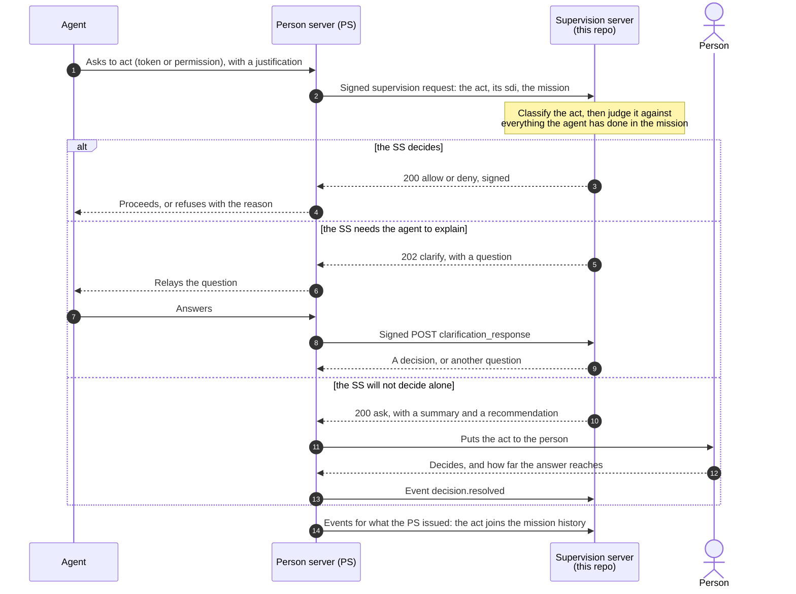
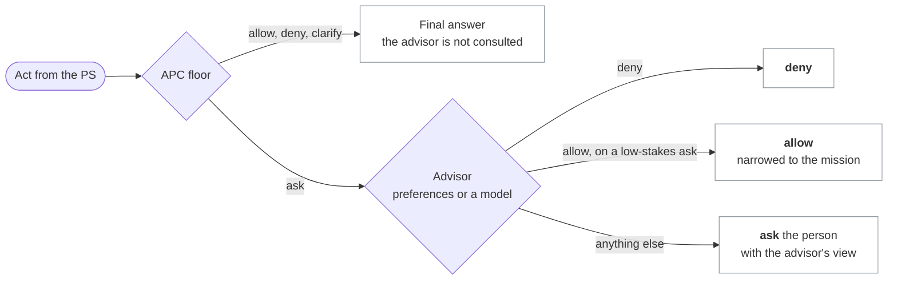
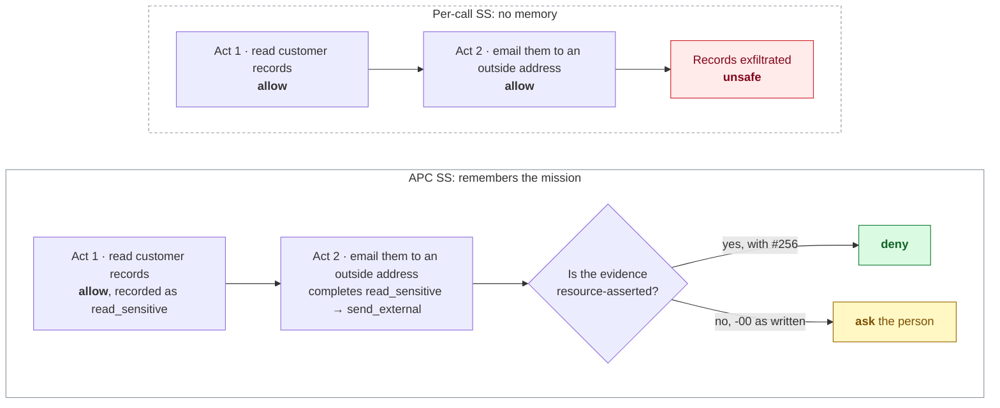

# aauth-supervision-server

[](https://github.com/xmuruaga/aauth-supervision-server/actions/workflows/ci.yml)
[](LICENSE)
[](pyproject.toml)
[](tools/check.py)

An independent Supervision Server (SS) for
[AAuth Supervision -00](https://dickhardt.github.io/AAuth/draft-hardt-aauth-supervision.html),
with a deterministic, composition-aware policy based on the Agentic Principal Chain
(APC) model of [Bounded Agents](https://arxiv.org/abs/2608.15888).

The SS is the party a person server (PS) asks "may this agent do this?" on the
person's behalf. This one answers from the act and from everything the agent has
already done in the mission. The default policy consults no model, so the same inputs
always give the same answer and every answer has a trace. A model can be layered on top
without loosening what the policy protects (see "A deterministic floor with a model on
top").

## AAuth in brief

[AAuth](https://aauth.dev) is an HTTP authorization protocol for agents, by Dick Hardt,
author of OAuth 2.0. Every agent has its own cryptographic identity and signs each
request with HTTP Message Signatures (RFC 9421), so there is no pre-registration and no
shared secret to leak. A person server (PS) represents the person: identity, consent,
missions and audit. [AAuth Supervision](https://dickhardt.github.io/AAuth/draft-hardt-aauth-supervision.html)
lets the PS hand the decision on each act to a supervision server the person chooses,
which is the role this repository implements.

- [aauth.dev](https://aauth.dev): overview, walkthrough demo and the
  [protocol explorer](https://explorer.aauth.dev)
- [dickhardt/AAuth](https://github.com/dickhardt/AAuth): the drafts, issues for
  specification discussion, and the
  [implementations table](https://github.com/dickhardt/AAuth#implementations)
- The drafts, latest editor's copies (the versions this server is pinned to are under
  "Pinned versions"): the
  [protocol](https://datatracker.ietf.org/doc/draft-hardt-oauth-aauth-protocol/),
  [Supervision](https://dickhardt.github.io/AAuth/draft-hardt-aauth-supervision.html),
  [R3](https://dickhardt.github.io/AAuth/draft-hardt-aauth-r3.html) and
  [Budgets](https://dickhardt.github.io/AAuth/draft-hardt-aauth-budgets.html)
- [aauth-dev](https://github.com/aauth-dev): SDKs, demos and community implementations

## How it fits

The agent never talks to the SS. The PS asks on its behalf, and the SS answers in one
of four ways: `allow` or `deny` (it decides), `clarify` (it asks the agent something
first), or `ask` (it hands the act to the person).



## Try it

```
python -m venv .venv
source .venv/bin/activate            # Windows: .venv\Scripts\activate
pip install -e .
aauth-ss demo                        # watch the SS decide a short mission
aauth-ss demo --extension --trace    # the same mission with the R3 proposal forwarded
```

The demo runs the real server against the simulated PS in one process, with real
signatures and no network: a mission is approved, metered inference runs into an AAuth
Budgets ceiling and is let through again when the resource reports what it spent, and a
split exfiltration is put to the person (Supervision -00 as written) or denied by the SS
itself (`--extension`). `aauth-ss demo --show-policy` prints the policy it uses.

## What it does

- **The whole SS side of Supervision -00.** Metadata and JWKS, connect (with person
  interaction or tenant acceptance), mission proposal, approved, update, completion and
  terminated, the decision endpoint for `person_token`, `auth_token` and `permission`,
  events, deferred decisions and clarification, signed decisions, idempotence, replay and
  recovery, and the error table.
- **RFC 9421 signatures under the AAuth profile.** It verifies PS requests under the
  `jwks_uri` scheme with Ed25519 or ES256 (`alg` required, polymorphic algorithms
  refused) and signs its answers with `;req` components. Key discovery follows the
  Signature-Key egress rules: HTTPS only, no private destinations, DNS pinning, no
  redirects.
- **APC policy.**
  - **Action classes.** Declarative rules map each act to an action class.
  - **Provenance on every classification.** Evidence is tagged `resource`,
    `configured`, `agent` or `replay`. Evidence the agent asserts can make a class
    stricter, never looser.
  - **Composition closure.** Prohibited pairs and sequences are checked across
    resources, and across a delegation chain: history is per mission, so acts split
    between a parent agent, a sub-agent and a call chain still compose. A violation on
    certain evidence is denied; on uncertain evidence it is put to the person.
  - **Budgets** per mission, by count and by amount.
  - **AAuth Budgets at metered resources.** A per-mission ceiling in the resource's own
    unit, held against the `budget` offer and the signed `budget_consumed` record the
    resource puts in its resource token. An allocation counts as fully consumed until the
    resource reports what it spent, as Budgets requires of an issuer; an offer in another
    unit or scale is never converted, only put to the person.
  - **Intent:** acts outside the approved mission are asked.
  - **Reach of the person's answers:** `once`, `mission`, `always`, and per-composition.
- **R3 forwarding (opt-in extension).** When enabled (`r3_member` in the policy) it
  uses the R3 content the PS forwards (the change
  [AAuth #256](https://github.com/dickhardt/AAuth/issues/256) proposes): a per-call
  proposal, or the R3 document an ordinary R3 resource token references, checked
  against `r3_s256`. A document gives operations but no parameters, and digest-object
  parameters count as not visible. Off by default, so the
  server is spec-only Supervision -00 unless you opt in (see Limitations).

## Architecture: the policy is a plug

The protocol layer and the decision model are separate. `SupervisionServer`
(`service.py`) is pure Supervision -00 wire logic: it parses and verifies the signed
request, builds a normalized act, keeps the mission, history and reach state, signs the
answer, and handles idempotence and replay. It never reaches into *how* a decision is
made. The decision model is injected and reached only through the `SupervisionPolicy`
interface (`policy.py`): three methods (`classify`, `decide`, `decide_proposal`) and two
attributes (`r3_member`, `ask_on_mission_update`).

The APC policy in this repo is one implementation of that interface. Any object with the
same shape can replace it without touching the protocol layer: a flat allow-list, a rule
engine, an LLM adapter, or a human-in-the-loop queue. `tests/test_pluggable_policy.py`
proves this by driving the unmodified server end-to-end, through the real signed-request
path, with a deliberately trivial non-APC policy, and shows that both the APC `Policy`
and the trivial one satisfy the `@runtime_checkable` interface.

### A deterministic floor with a model on top

`examples/layered_policy.py` combines the two kinds of judgment the draft names, rules
and "a model applying the person's preferences", behind the same interface. The APC
policy decides first and its `allow`, `deny` and `clarify` are final. Only when it
would put the act to the person does an advisor speak:



What the advisor may do is asymmetric, because what it reads is agent-asserted:

| The advisor answers | Effect on the floor's `ask` |
|---|---|
| `deny` | Applies: refusing on the person's behalf can only make the SS stricter |
| `allow` | Applies only to a low-stakes ask: no prohibited composition, no unchecked budget, not high-impact, a certain class. Otherwise the person still decides |
| `ask`, an error, a timeout, anything malformed | The floor's `ask` stands; the advisor's view goes into the `summary` |

Two advisors are included: `PreferenceAdvisor`, standing preferences the person wrote,
and `ModelAdvisor`, any language model behind a `complete(prompt) -> str` function you
supply, with a strict JSON answer and the agent's text fenced as untrusted.
`tests/test_layered_policy.py` pins the contract, including a model that a prompt
injection has turned into "allow everything", a property test over arbitrary floor
answers and advice, and a run through the unmodified signed server.

## Results

- `docs/conformance-matrix.md` is generated from the pinned drafts. It covers 89 BCP 14
  keyword rows from Supervision -00, R3 and core, plus 17 SS obligations the draft states
  in plain prose: 83 tested, 23 n/a (each binds another role, with the reason given),
  0 open. Every tested row names its tests.
- `docs/adversarial-results.md` gives the critical-act decision in ten attack
  scenarios under four configurations.

The core case is T2. Each act is harmless alone; together they exfiltrate data. Only a
supervisor that remembers the mission sees it, and how firmly it can act depends on
what the wire lets it verify:



All ten scenarios:

| Configuration | correct | escalated to the person | unsafe |
|---|---|---|---|
| per-call SS (no composition, sees the proposal) | 3 | 0 | 7 |
| APC, Supervision -00 as written | 3 | 7 | 0 |
| APC, proposal forwarded in `auth_token` ([#256](https://github.com/dickhardt/AAuth/issues/256)) | 9 | 1 | 0 |
| APC, proposal also in `auth_token.issued` ([#257](https://github.com/dickhardt/AAuth/issues/257)) | 10 | 0 | 0 |

How to read it:

- The per-call SS is not a separate design: it is this engine with the same rules and
  the same visibility of the proposal, and only composition and budgets removed.
- A memoryless SS is unsafe: an agent can split an exfiltration into acts that are each
  fine alone, and spend past a ceiling one allocation at a time.
- APC on today's wire is safe but mostly cannot decide. It puts the act to the person,
  and the person then sees only what the agent claims. The exception is metered spend
  (T10): AAuth Budgets puts the resource's offer and its signed consumption record in the
  resource token, so the SS can hold a ceiling with no change to the wire.
- Forwarding the proposal lets the SS decide. The remaining case, T9, is a routing change
  after a sensitive result was released. It needs the proposal in the issuance event as
  well, so it survives replay to a new SS.

## Spec feedback

Implementing the SS surfaced four questions in the drafts, filed upstream:

| Issue | Question | Finding |
|---|---|---|
| [dickhardt/AAuth#256](https://github.com/dickhardt/AAuth/issues/256) | The R3 per-call proposal does not reach the SS | F1 |
| [dickhardt/AAuth#257](https://github.com/dickhardt/AAuth/issues/257) | A released `result` does not reach later decisions or a replacement SS | F2 |
| [dickhardt/AAuth#258](https://github.com/dickhardt/AAuth/issues/258) | The "same signed response" on a retry goes stale under a freshness window; an `sdi` reused for a different request | F6, F3 |
| [dickhardt/AAuth#259](https://github.com/dickhardt/AAuth/issues/259) | An SS `allow` cannot size a Budgets allocation (nor an R3 grant) | F8 |

Each finding in `docs/findings.md` gives the draft text, the effect, what this SS does
about it, and the tests that show it. The rest of that file records implementation
choices where the draft leaves room.

## Run it

```
python -m venv .venv
source .venv/bin/activate            # Windows: .venv\Scripts\activate
pip install -e ".[dev]"
pytest -q                            # the full suite
python tools/check.py                # every merge gate, offline (see Quality)

aauth-ss keygen --kid ss-2026-10 --out keys/ss-key.json
aauth-ss check-policy examples/policy.json
aauth-ss explain examples/policy.json --resource https://mail.example --scope mail.send
aauth-ss serve --config examples/server.json --policy examples/policy.json \
    --key keys/ss-key.json --state state/ss.json --port 8443

python tools/extract_matrix.py       # regenerate the conformance matrix (--check to verify)
python tools/run_adversarial.py      # regenerate the adversarial results (--check to verify)
```

`serve` binds a loopback address only and refuses any other. Put a TLS-terminating
reverse proxy for the `issuer` origin in front of it, and have it pass the original
`Host` header through: the PS signs `@authority`, and the SS checks it. The connect
confirmation page (`/interaction`) is protected by an operator token
(`admin_token` in the config, or `AAUTH_SS_ADMIN_TOKEN`). It is a development stand-in
for a real person-facing confirmation with the person's own authentication.

## Quality

`tools/check.py` is the merge gate, and CI (`.github/workflows/ci.yml`) runs the same
script on Linux, macOS and Windows with Python 3.11 to 3.13. Once dependencies are
installed it needs no network and no running second implementation:

| Gate | What it enforces |
|---|---|
| ruff, mypy | Lint, and strict typing of `src/` (`disallow_untyped_defs`) |
| pytest under branch coverage | The deterministic suite, with 100% line and branch coverage of `src/` (`fail_under = 100`, no inline `pragma: no cover`) |
| properties | The Hypothesis property tests, kept out of the coverage measure so 100% never depends on a random draw |
| conformance matrix | `docs/conformance-matrix.md` is regenerated from the pinned drafts and must match |
| adversarial results | `docs/adversarial-results.md` is re-run and must match |

The suite is layered:

- **Conformance.** Every tested matrix row names its tests (`@pytest.mark.req`).
- **Standard vectors.** RFC 9421 Appendix B signatures are reproduced or verified
  byte for byte (`tests/test_rfc9421_vectors.py`).
- **Independent implementations, in two languages.** Requests signed by
  [regent-httpsig](https://github.com/regent-protocol/regent-httpsig) (Python, from the
  AAuth README's implementations table) and by
  [auth-go](https://github.com/aauth-dev/aauth-go) (Go, the AAuth module on aauth.dev,
  draft -11) verify here, and this code's signatures verify with both. With auth-go the
  check goes further: a whole mission runs against the unmodified server with every PS
  request signed by auth-go, ending in the split exfiltration denied
  (`tests/test_interop_regent_httpsig.py`, `tests/test_interop_auth_go.py`,
  `docs/interop.md`).
- **Fuzzing and properties.** Signature headers, structured fields, snapshots and the
  service state machine are fuzzed. Hypothesis checks the parser invariants
  (`tests/test_properties.py`).
- **Model-based lifecycle.** A Hypothesis state machine drives the real server with
  random sequences of requests, answers, polls, withdrawals, retries, resolutions and
  clock ticks, and checks every answer and stored decision against a small model
  (`tests/test_properties_lifecycle.py`). Re-introducing either of two known lifecycle
  defects (SUP-P15, SUP-P17) makes it fail with a three-step counterexample.
- **Engine semantics.** Each policy rule is pinned at its boundary, so a scenario that
  happens to still pass cannot hide a regression (`tests/test_policy_semantics.py`).
- **Mutation testing.** `policy.py`, `httpsig.py` and `service.py` are mutated and
  every surviving mutant is either killed by a test or recorded as equivalent, with the
  reason (`docs/mutation-testing.md`, which lists the lines added since the last
  campaign).

## Layout

| Path | What |
|---|---|
| `src/aauth_supervision_server/service.py` | Protocol logic: one `handle(request) -> response`, no sockets |
| `src/aauth_supervision_server/policy.py` | The APC policy engine |
| `src/aauth_supervision_server/httpsig.py`, `sfv.py`, `jwk.py` | RFC 9421, RFC 8941 structured fields, JWK algorithm determination |
| `src/aauth_supervision_server/resolver.py`, `egress.py` | `jwks_uri` key discovery under egress admission |
| `src/aauth_supervision_server/store.py` | State, with a versioned JSON snapshot; an unreadable snapshot is set aside and rebuilt by PS replay |
| `src/aauth_supervision_server/http_server.py`, `cli.py` | Loopback listener and the `aauth-ss` command |
| `src/aauth_supervision_server/testing.py` | A simulated PS that speaks Supervision -00, with real signatures and tokens |
| `src/aauth_supervision_server/adversarial.py` | The T1-T10 scenarios |
| `src/aauth_supervision_server/demo.py` | `aauth-ss demo`: a narrated mission against the real server |
| `specs/` | The drafts the implementation is pinned to |
| `examples/` | A server config and an APC policy, and `layered_policy.py` (the floor with an advisor) |
| `docs/` | Conformance matrix, adversarial results, findings, interop probe, mutation testing |
| `tools/` | `check.py` (the offline gate), matrix and adversarial generators, `mutation_recheck.py` |
| `interop/auth-go/` | A thin Go command over auth-go's signer and verifier, driven by `tests/test_interop_auth_go.py` |
| `.github/workflows/ci.yml` | The same gate on Linux, macOS and Windows, Python 3.11 to 3.13 |

## Pinned versions

The drafts are taken from the AAuth repository at
`70d67375deb0bb002af7da0711fc58f6e8926e7e`: Supervision -00, R3, Budgets, the
protocol editor's copy and Events, plus HTTP Signature Keys -09. Supervision is marked
"Exploration, not yet submitted" and will change.

## Limitations

- **No second Supervision implementation tested against.** No public PS speaks
  Supervision -00 yet (`docs/interop.md`). The signature layer is cross-tested with two
  independent libraries, in Python and Go, and auth-go signs every PS request of one
  full mission, but the Supervision logic of the PS side is still this project's own
  simulated PS, so Supervision interoperability is claimed against one reading of the
  draft.
- **Extensions to the draft.** Forwarding R3 content (`r3_proposal` in the
  decision request and in `auth_token.issued`, proposed in [AAuth #256](https://github.com/dickhardt/AAuth/issues/256): a per-call
  proposal, or the R3 document an ordinary R3 resource token references) is not in
  Supervision -00. It is **off by default**: with no `r3_member` in the policy the server
  is spec-only and ignores the member. `examples/policy.json` opts in
  (`"r3_member": "r3_proposal"`) to demonstrate it; everything works without it, more
  conservatively.
- **Budgets: the SS can hold a ceiling but cannot size an allocation.** Budgets puts
  that decision ("Sizing the allocation is where the PS's supervision happens") with the
  party that supervises, but a Supervision -00 `allow` can narrow only `scope` and `exp`,
  and a `deny` carries no `suggested_budget`
  ([AAuth #259](https://github.com/dickhardt/AAuth/issues/259)). So an offer that would cross the ceiling is
  put to the person with the headroom stated, rather than granted in part. The SS also
  assumes the PS granted the resource's whole offer, since `auth_token.issued` does not
  say what was granted, and it cannot read the resource's usage counters, because it
  calls no one. Acts replayed to a new SS carry no budget, so a ceiling at that resource
  asks until fresh figures arrive. It relies on the draft's in-order delivery: the
  issuance of one allocation reaches the SS before the next request at that resource.
- **One process.** State is in memory with a JSON snapshot behind one lock, and nothing
  is evicted: missions, decisions and events are kept for the life of the state file
  (the draft requires keeping a decision at least until the tokens it allowed expire,
  and allows longer). That is enough for conformance and interop work, but it is not a
  datastore.
- **The policy is only as good as its rules.** Classification is declarative over
  resources, operations, scopes, tools, parameters and R3 results. An act the rules do
  not anticipate falls to `default_class`.
- **Clarification is answered from the agent's reply alone.** A clarification adds to the
  justification and is therefore agent-asserted, so it can never lower a class.

## Background and citing

The policy model is the Agentic Principal Chain (APC) from **Bounded Agents: Delegation
Security for Multi-Agent AI Systems** (<https://arxiv.org/abs/2608.15888>). The paper's
thesis, that an agent's authority must be judged over the whole chain of what it has
already done and not act by act, is what `docs/adversarial-results.md` demonstrates in
running code: a memoryless supervisor is unsafe where a composition-aware one is not.

If you build on this work, please cite the paper (`CITATION.cff` holds the same
metadata, behind GitHub's "Cite this repository"):

```bibtex
@misc{muruaga2026boundedagents,
  title         = {Bounded Agents: Delegation Security for Multi-Agent AI Systems},
  author        = {Muruaga, Xabier},
  year          = {2026},
  eprint        = {2608.15888},
  archivePrefix = {arXiv},
  primaryClass  = {cs.AI},
  doi           = {10.48550/arXiv.2608.15888},
  url           = {https://arxiv.org/abs/2608.15888}
}
```

This repository implements the Supervision Server role; it is independent of, and not
endorsed by, the AAuth draft authors.

## License

Apache-2.0, except the drafts in `specs/`, which are unmodified copies under the IETF
Trust's terms (`specs/README.md`).
